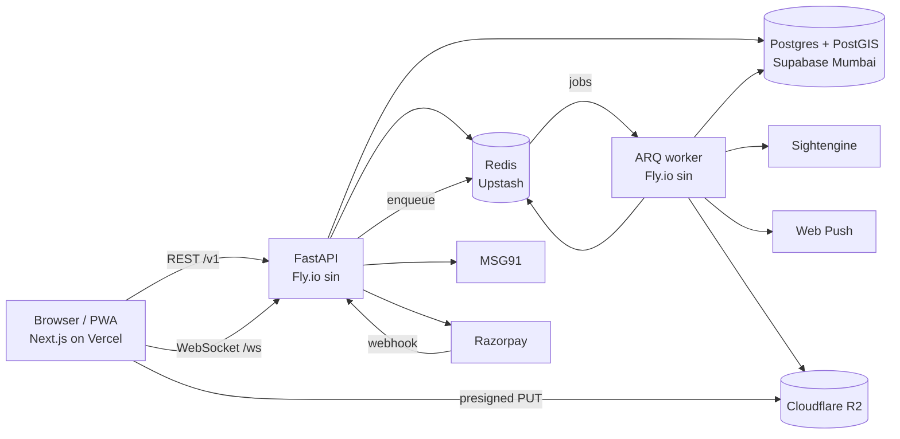
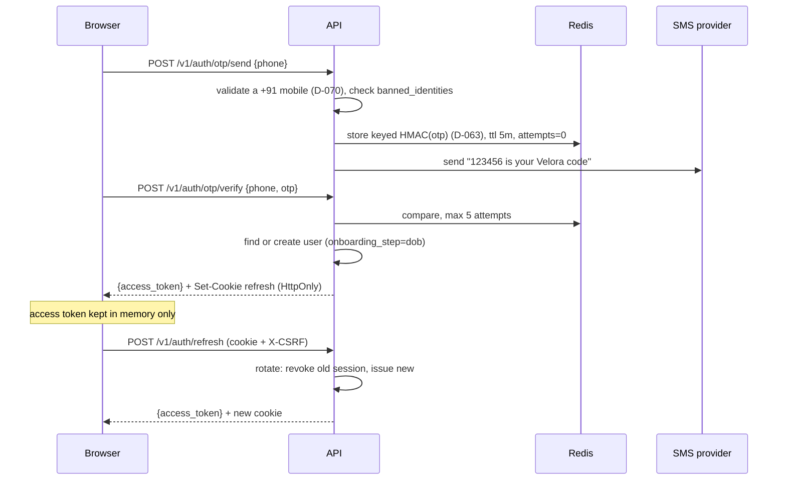

# 02 · Architecture

## 1. System map



## 2. Backend layout and layers

```
api/app/
  main.py                 app factory, middleware, router mounting
  core/
    config.py             pydantic-settings; every env var declared here
    db.py                 async engine, session dependency, transaction helper
    redis.py              client, pub/sub helpers
    events.py             socket events: queued on the session, published after commit (T-5.1)
    security.py           phone numbers, access and refresh tokens, PINs, CSRF (D-060)
    errors.py             AppError + handlers → error envelope
    enums.py              the 20 Postgres enum types as Python enums (shared across modules)
    deps.py               current_user, require_role, rate_limit
    pagination.py         every list's Page[T], cursor and limit (T-5.3, D-270)
    providers/            sms.py payments.py moderation.py facematch.py push.py storage.py
                          each: Protocol + RealImpl + FakeImpl
  modules/
    auth users profiles onboarding photos verification discovery swipes matches
    threads messages album kudos gifts safety wallet payments referrals
    notifications admin waitlist realtime
  workers/
    main.py               ARQ WorkerSettings, cron schedule
    tasks/                moderate_photo, verify_selfie, expire_threads, warn_expiring,
                          send_push, recompute_fraud, watermark_album
```

**Each module:** `router.py` (FastAPI routes) · `schemas.py` (Pydantic in/out) · `service.py`
(rules) · `repository.py` (SQL) · `models.py` (SQLAlchemy tables).

**Dependency direction:** router → service → repository → models. A service may call another
module's **service**, never its repository. Nothing imports from `router.py`.

**Transactions** are opened in the service layer with `async with db.begin():`. Repositories take a
session and never commit.

## 3. API conventions

- Base path `/v1`. JSON only. `snake_case` fields.
- **Except the probes:** `/healthz` and `/readyz` are mounted at the root, unversioned. They
  are read by Fly and uptime checks, not clients, so they are not part of the versioned API.
- Auth: `Authorization: Bearer <access_jwt>` on every route except those marked public.
- **Pagination (D-270):** cursor-based, through `core/pagination.py`. Request
  `?cursor=<opaque>&limit=20`, `limit` 1 to 50: outside that, `VALIDATION_ERROR`, never clamped.
  Response `{ "items": [...], "next_cursor": "..." | null }`, named `<Item>Page` in the schema. The
  cursor is the last item's sort key, unsigned: a position, never a permission, since every list
  filters by who is asking. One the API didn't write is `VALIDATION_ERROR` on `cursor`.
- **Idempotency:** mutating money routes accept an `Idempotency-Key` header. The guarantee is the
  ledger's own key in Postgres, permanent and namespaced by the wallet module (D-077); a client's
  key only ever fills its event part. A Redis store, if a route builds one (T-8.1 or T-8.9), only
  replays the earlier response. It is never what stops a double charge.
- **Time:** ISO-8601 UTC strings.
- **Error envelope** (every non-2xx):

```json
{ "error": { "code": "INSUFFICIENT_CREDITS", "message": "You need 5 credits.", "details": { "required": 5, "balance": 2 } } }
```

HTTP status mapping: 400 validation · 401 `AUTH_REQUIRED`/`TOKEN_EXPIRED` · 402 `INSUFFICIENT_CREDITS`
· 403 `FORBIDDEN`/`ACCOUNT_FROZEN` (`BLOCKED` is never sent: across a block, `NOT_FOUND`, D-862) · 404 `NOT_FOUND` · 409 conflict codes · 410 `THREAD_EXPIRED`
· 422 business-rule codes · 429 `RATE_LIMITED`. Full code list in `04-API.md`.

## 4. Auth flow

Two providers, one session model. `AUTH_PHONE_PROVIDER` selects which path is live (D-035).

**Path A — Firebase (launch default)**

```mermaid
sequenceDiagram
  participant B as Browser
  participant F as Firebase
  participant A as API
  B->>F: signInWithPhoneNumber(+91…) with invisible reCAPTCHA (App Check from P-68)
  F-->>B: SMS, then confirm(code) → Firebase ID token
  B->>A: POST /v1/auth/firebase {id_token}
  A->>A: verify signature + aud/iss/exp/iat/auth_time against Google keys, a phone sign-in, +91 only
  A->>A: used once; throttle per IP and per phone; check banned_identities
  A->>A: find or create user (same as Path B)
  A-->>B: {access_token, user} + refresh and CSRF cookies
  B->>F: signOut: we keep our own session
```

The Firebase ID token is used once, never stored, and never accepted twice. It carries no `jti`,
so its SHA-256 is held in Redis until it would expire (D-085). Its sign-in must be under 5 minutes
old. Served only where `AUTH_PHONE_PROVIDER` is `firebase`; 404 elsewhere (D-085). The browser asks
Google for the SMS, so none of our server's limits stands in front of a send (D-035, P-0.18).

**Path B — own OTP over MSG91 (after DLT approval)**



- OTP (Path B, served only where `AUTH_PHONE_PROVIDER` is `msg91` or `fake`): 6 digits, 5-minute
  TTL, 5 verify attempts per code and 10 wrong codes per phone per 24 hours, resend after 45 s;
  send limits and the global daily cap are in §12 (D-066). Only Indian mobile numbers sign in
  (D-070).
- **Refresh reuse detection:** presenting a revoked refresh token revokes the whole session family,
  unless it was rotated less than 10 seconds ago, which two tabs refreshing at once cause: that
  is refused without revoking (D-067). Logout authenticates like refresh, by cookie and `X-CSRF`.
- Phone numbers are stored encrypted in the API (Fernet, `PHONE_ENC_KEY`), never by the database,
  plus an HMAC-SHA256 keyed by `PHONE_PEPPER` for lookup (D-061). PINs are argon2id over a
  pepper kept off the database (D-062).

## 5. Onboarding state machine

`users.onboarding_step`: `dob → gender → seeking → profile → username → about → photos → interests →
pin → selfie → done`. The API rejects discovery/threads calls with `ONBOARDING_INCOMPLETE` until
`done`. Women cannot reach `done` without an approved selfie verification:
`POST /me/onboarding/complete` moves `selfie` to `done` once every requirement is met, and for anyone but
a man only with a matched selfie; a trigger refuses any write that moves anyone else to `done`
unmatched (T-4.8, D-310). In the same transaction a man reaching `done` is given welcome Velas
through `wallet.credit(welcome)`, once per phone number, ever (`welcome_grants`, T-8.11, D-470). Each step's endpoint works at its step (advancing it) and after it (an
edit that doesn't advance), and refuses before it with `ONBOARDING_INCOMPLETE` and the current step
(D-068). `gender` and `dob` are immutable once set (T-1.9's trigger), and a date of birth under 18
deletes the account, keeping only the number's hash (D-072).

The location question (T-4.10, D-220) has no step of its own. It is asked after `profile` (Name),
before `username`: `PUT /me/location` works from `username` on and never moves the step, and `Me`
says whether a location is set, so the web sends anyone past Name without one to it.

## 6. Real-time protocol

Connect: `POST /v1/ws/ticket` → `{ticket}` (single use, 30 s) → `wss://api.veloraapp.co.in/ws?ticket=…`,
from one of the web's exact origins (D-557, T-7.4). Closed by the server: 4401 no live ticket,
4403 another origin (before it opens), 4408 silent 60 s, 4000 the user's sessions were revoked,
1013 too slow to keep up. Each API instance holds one Redis subscription for the users connected
to it (`modules/realtime/hub.py`).

Envelope, both directions: `{ "type": "…", "id": "<uuid>", "data": { … } }`

| Server → client | When |
|---|---|
| `message.new` | new message in a thread you're in |
| `message.read` | the other person read up to a message: `{thread_id, up_to_message_id, read_at}`, the newest of yours they marked (T-7.5, D-670) |
| `typing` | other person typing: `{thread_id}` alone (T-7.5, D-670) |
| `thread.opened` | someone opened a thread with you |
| `thread.expiring` | `thread_warn_minutes` (10) left; to him only, never her (T-7.6) |
| `thread.expired` | expired; to him only (T-7.6) |
| `knot.requested` | the other tapped "Tie the knot": `{thread_id, user_id}`, the tapper; to the other alone (T-7.7) |
| `knot.accepted` | both have tapped, so the Thread is a Knot: `{thread_id, knotted_at}`, to both (T-7.7) |
| `knot.untied` | the other untied the Knot: `{thread_id}`, to the other alone; no expiry in it (D-554, T-7.7) |
| `wallet.updated` | balance changed |
| `match.created` | a like or Super Like met one back (T-6.4): `{match_id, user_id}`, the other person, to both |
| `album.decided` | album request granted / declined (T-8.4): `{album_request_id, user_id, granted}`, `user_id` the owner, to the requester |
| `album.requested` | a new request to see her private pictures (T-9.4, P-631): `{album_request_id, user_id}`, `user_id` the requester, to her |
| `gift.received` | a gift sent to you (T-8.9): `{gift_send_id, gift_id, user_id}`, the sender |

| Client → server | Effect |
|---|---|
| `typing` | `{thread_id}`: relayed to the other participant, never the typist's own sockets, nor across a block. One a Thread every 3 s and 40 a minute in all, both in Redis before one short database read; anything else dropped quietly, the socket left open (T-7.5, D-670) |
| `ping` | server replies `pong`; client reconnects if no pong in 10 s. Ping well inside 60 s: a socket silent that long is closed (4408) |

Sending messages is **REST** (`POST /v1/threads/{id}/messages`) so it goes through validation,
masking and persistence; the socket only pushes. Client dedupes by `client_msg_id`.
Fan-out: API publishes to Redis channel `user:{id}`; every API instance subscribes for its
connected users. A service queues an event in the transaction that makes it true; `get_session`
publishes the request's committed events when the request ends, after its session has closed, and
a failed or hung publish (1 s) is logged without failing the request (`core/events.py`, T-5.1).
The worker's jobs and the socket's own reads publish the same way, each session as it closes
(`core.db.publishing`, P-592), so a credit made in a job moves the balance on screen.
`socket.close` is the server's own: queued where a user's sessions are revoked, it closes every
socket of theirs and is never sent to a client (T-7.4).

## 7. Background jobs (ARQ)

| Job | Trigger | Does |
|---|---|---|
| `moderate_photo` | photo upload completed | re-encode (D-092: decoded and encoded afresh, so no EXIF survives), score with Sightengine (D-094), decide: approve → the scored bytes to the public bucket; a possible minor → rejected, a `fraud_events` score, every copy deleted (D-093) |
| `blur_photo` | a public photo approved; `GET /likes` for one approved before T-6.7 | its public copy shrunk to 24 px, softened and spread to 240, written to the public bucket under a fresh key and recorded in `photos.blur_key` only if the photo is unchanged, else the file deleted (D-543). 3 tries |
| `delete_files` | under-18 refusal, before its commit | delete the refused user's files once they're gone, each read back (D-090) |
| `verify_selfie` | selfie submitted, then a wake (D-261) | the selfie re-encoded, then face match vs the approved photos' public copies, on the worker itself: YuNet and SFace (D-088), no third party (D-087), at SFace's published 0.363 (D-260); approved → `is_verified`. A wake on `wake:verify_selfie`, published after the submit commits, runs it at once; the queued job is the path sure to run. Liveness is T-4.11's, and nothing claims it until then (D-262) |
| `export_data` | `POST /me/export`, after its commit | a user's own data as JSON to the private bucket, key recorded first; `ready` for 24 hours (D-502). 3 tries, the last marking it `failed` |
| `expire_export` | `export_data`, 24 h on | delete the export's file, read back as gone; `expired` (D-502) |
| `erase_accounts` | cron, daily 03:30 IST (the worker's only cron) | erase every account deleted ≥ 29 days ago, files first, by D-503's lists, then anonymise its row (D-500); expire any export file its own job left |
| `watermark_album` | album request granted or revoked; the album missing a photo's copy; a private photo removed | bring one request's copies in line with it (D-730): while granted, each private photo with a scored copy rendered from `scored_key`, never `raw_key` (D-700), with the viewer's `@username` tiled diagonally at ~20% opacity, written to `album/{request_id}/{photo_id}.jpg` and recorded in `album_copies` only if still granted, else the file deleted; otherwise every copy deleted, file read back as gone, then its row. A job id per reason, since ARQ refuses a finished id for an hour. 3 tries |
| `send_push` | a wake on `wake:send_push` after a notification commits, and the worker's minute (D-850); never an ARQ job | `push_outbox` claimed in batches (`SKIP LOCKED`), sent by VAPID Web Push (RFC 8291, D-856) with no lock held: an active account, its setting on, under an hour old, nobody blocked since, and a message only while no socket of theirs is open (`PUBSUB NUMSUB`, D-854). 404/410 deletes the subscription; 3 tries |
| `expire_threads` | the worker's minute (D-640) | active threads past `expires_at` → `expired`, `thread.expired` to him only, in batches of 500, `SKIP LOCKED` (T-7.6) |
| `warn_expiring` | the worker's minute (D-640) | threads with `thread_warn_minutes` (10) or less left, warned once per expiry: `thread.expiring` and a notification, him only (T-7.6) |
| `recompute_fraud` | cron every 10 min + on report | recompute score, apply band actions |
| `cleanup` | cron, daily 03:30 IST | purge expired OTP keys, old WS tickets, stale push subs |
| `log_turnover` | cron, daily 03:30 UTC (09:00 IST) | the financial year's paid turnover, logged: warning from ₹15 lakh, error from ₹20 lakh (D-483, P-350). The worker's cron schedules are in UTC (`WorkerSettings.timezone`) |

Every job is idempotent and safe to retry (max 3, exponential backoff).

The worker (T-4.4) is `python -m app.workers` (`make worker`): the API's image and `Settings`, the
same database role, its own Fly app (`infra/fly.worker.toml`, D-095). It polls every
`WORKER_POLL_DELAY_S`, 10 seconds (D-091), and refuses to start without what its jobs need.
ARQ logs each job's arguments as it starts it; the worker writes the job's name instead, since
`delete_files`' arguments are storage keys (rule 15).

## 8. Discovery query

`discovery.repository.feed_query` (T-6.2) builds it. Every position in it is a point of D-490's
0.01° grid, the viewer's too, so the radius, the distance and the ranking are all measured
between grid points: nothing tells anyone more than which cell, about 1 km², a person is in.

```sql
SET LOCAL jit = off;                                    -- D-495: compiling cost more than the query
SELECT user_id, score, distance_m FROM (
  SELECT u.id AS user_id, ST_Distance(p.location, :me) AS distance_m,
         rank_score(distance_m, u.last_active_at, u.is_verified, p.completeness, :as_of) AS score
  FROM users u JOIN profiles p ON p.user_id = u.id
  WHERE ST_DWithin(p.location, :me, :radius_m)          -- app_config's discovery_radius_km
    AND u.id <> :me_id AND u.status = 'active' AND u.onboarding_step = 'done'
    AND p.is_hidden = false
    AND u.gender = ANY(:wanted_genders) AND p.seeking = ANY(:seekings_wanting_my_gender)
    AND NOT EXISTS (fraud_scores band 'freeze')          -- D-031
    AND NOT EXISTS (fraud_scores band 'shadow')          -- unless the viewer is shadowed
    AND NOT EXISTS (SELECT 1 FROM swipes s WHERE s.swiper_id = :me_id AND s.target_id = u.id)
    AND NOT EXISTS (a standing block either way, matched by number: D-860, D-861)
    -- optional: intents (any overlap: EXISTS on profile_intents, D-041), the badge, online
) ranked
WHERE (score, user_id) after the cursor's               -- score < :s OR (score = :s AND id > :id)
ORDER BY score DESC, user_id
LIMIT :limit + 1;
```

`rank_score` is D-491's, in `discovery/rules.py`: `0.40·D + 0.30·R + 0.15·V + 0.15·C`, with D =
1/(1 + km/5), R = 1/(1 + hours since active/24) (0 if never), V = `is_verified` (D-032, P-290:
the ranking keeps it whether or not the badge shows), C = completeness/100; the `new` feed adds 1
for anyone who joined within 7 days. Every candidate is scored: a window of the nearest 2,000 was
built and measured, and saved nothing (D-495). Every term is measured at `as_of`, the instant the scroll's
first page was ranked, which each cursor carries, `(as_of, score, user_id)`: a scroll is one
ranking. The page's cards (age, main photo, badge, intents) are read for its rows alone. Who may
be seen, without the radius and swipes, is `visible_to`, which the public profile (T-6.3) and
swipes (T-6.4) share.

**The `Card`'s badge (D-393, T-4.12)** is never raw `is_verified`. It is `is_verified` (the selfie
matched the face photo, D-391) **and** at least one shown face that matched that selfie, an EXISTS
on `photos`, `verification.repository.badge_of`, which `shows_badge` reads and T-6.2's `Card`
(`shows_badge`) and filter carry:

```sql
u.is_verified AND EXISTS (
  SELECT 1 FROM photos ph
  WHERE ph.user_id = u.id AND ph.kind = 'public' AND ph.status = 'approved'
    AND ph.public_key IS NOT NULL
    AND (ph.moderation -> 'selfie_match' ->> 'matched')::boolean
) AS badge
```

The `Card`'s main photo is the approved public photo at the lowest place, 0 or not: the server
never closes a gap (P-75, D-494). Its URL is null when there is no approved public photo (D-392);
the web shows a grey silhouette with the name. The "verified" filter (`verified=true`, and T-6.9's
chip) filters on this badge.

**Search (T-6.6, D-540)**, `discovery.repository.username_search_query` and `text_search_query`,
reads the same `visible_to`. `@` and a username's start: `visible_to` without seeking (a link
reaches past it, D-493), no radius, never a hidden profile, swiped or not; `ILIKE` on the prefix
with `\`, `%` and `_` escaped; the exact username first, then the rest by username in byte order
(`COLLATE "C"`), the cursor `(exact, username)`. Text: `visible_to`, mutual, within
`discovery_radius_km` (`ST_DWithin`), swiped or not, matching a name or username by trigram (`%`,
`SET LOCAL pg_trgm.similarity_threshold = 0.3`) or prefix, a city by prefix, or an intent or
interest whose label holds the text; best name similarity first, then by id, the cursor `(score,
user_id)`. A row is a `SearchResult`, read through `cards()` as the feed's are.

Indexes that make this fast are listed in `03-SCHEMA.md`. Target: p95 < 80 ms at 50k users, for
the spread shape, what beta looks like; the launch shape (50k inside one city's 25 km) is accepted
above it, about 200 ms, until P-391's cell-first ranking (D-495).
`tests/modules/discovery/test_plan.py` holds that a spread crowd is searched through the GIST
index; the timing is `api/bench/discovery`'s, run by hand (the founder, 8 October 2026: a timing
on a shared CI runner fails at random), its numbers in T-6.2's tick.

## 9. Money flows

**Spend (e.g. open a thread):**
1. `async with db.begin():` → `pricing.service.charge(session, user, action, ref=Ref(...))` reads
   the price from `action_prices` inside that transaction, with no cache, so it charges the price
   as it is now: 0 for a woman, the row's value for a man (T-5.2). Only above 0 does it call
   `wallet.debit()`, and nothing else may, but gift sending (T-8.9, priced from `gifts`); a test
   holds that as an allowlist, and since P-152 `debit()` itself refuses any other caller when it
   runs (D-651). **It is given the price the screen showed** (`shown`, the request's
   `shown_price`, 0 when absent) and refuses with `PRICE_CHANGED` when the price now differs,
   before any debit: compared, never charged (P-56, D-600).
2. `wallet.debit(session, user_id, amount, reason, ref=Ref(...))` locks the wallet row, checks
   balance, updates balance, inserts ledger entry. The caller never builds the key: the wallet
   does, from the reason and the ref, or from an event the caller names for the reasons that
   repeat (`thread_reopen`, `thread_extend`, `admin_grant`). A retry returns the first entry with
   `applied=False` (D-077, T-5.1).
3. The thing being bought (thread row) is created **in the same transaction**. Either both happen
   or neither does.

**Purchase:**
1. `POST /v1/payments/orders {pack_id}` + `Idempotency-Key` → server prices it from the pack's
   row, creates the Razorpay order, stores the `payments` row (`created`, `gst_paise` 0), returns
   `order_id` + public key. The same key again is the same order (D-481); a woman is refused
   first (D-076).
2. Browser checks the order's amount is the price it showed (else the packs again, nothing
   charged), then opens Razorpay Checkout, its script loaded on demand; on local and CI builds a
   stand-in of our own instead, and the fake gateway's local-only webhook pays (T-8.7, D-761).
   Closed without paying, "Try again" reopens the same order, never a second one.
3. Razorpay → `POST /v1/payments/webhook` (`payment.captured`), T-8.2 (D-520 to D-524). Verify
   the signature over the raw body, or `400`. In one transaction: lock the row by its order
   (`FOR UPDATE`); none → `200`, logged. Anchor (`provider_payment_id`) already this payment's →
   `200`, a repeat; another payment's → nothing credited, an error for T-8.3. Amount or currency
   not the row's → `failed`, nothing credited. Owner not a man → `failed`, an error: refund it by
   hand (D-076). Else `paid`, the anchor, `paid_at` by our clock, the allowlisted `raw_webhook`;
   `wallet.credit(purchase, row.credits)`, which locks the wallet; **then**, under that lock, the
   bonus only if no other payment of his is `paid` or `refunded`, else `bonus_credits` 0 (D-522).
   A `payment.failed` makes a `created` row `failed` and never sets the anchor, so a later capture
   on the order still credits (D-523).
4. Browser polls `GET /v1/payments/{id}` every 1.5 s until `paid`, for 60 s at most, then
   refreshes the wallet and the packs (the bonus is gone after a first purchase). `failed` doesn't
   end it: one order can fail and then be captured. No `paid` in 60 s: "still confirming", with
   "Check again" and the claim (T-8.7, D-761).

**Money back (D-076 rule 3, D-520):** a refund or chargeback made in Razorpay's dashboard reaches
the same webhook, one transaction per event, the row locked by the payment (or its order):
- `refund.created`, `payment.dispute.created`: not yet captured → captured first from the signed
  payment in the event (order isn't guaranteed). Then `wallet.reverse(purchase_reversal)` takes
  what the payment granted, less what was already taken back for it, down to a balance of 0; the
  rest is a shortfall, logged, and on a dispute a `chargeback_shortfall` signal. Status stays
  `paid`.
- `refund.failed`, `payment.dispute.won`: `wallet.credit(purchase_restored)` of exactly what that
  refund's or dispute's reversal took (keyed by its id), or nothing.
- `refund.processed`, `payment.dispute.lost`: reversed first if `.created` hasn't come, then
  `refunded`: turnover (D-483) stops counting it.
- Each refund or dispute is handled once, by its own id, whatever it took: `payment_reversals`
  records it, 0 taken included, so a redelivery after he has bought Velas again takes none of them
  (P-420, D-581).

**A broken payment's claim (D-050, T-8.3, D-580):** a man files `POST /v1/refund-requests
{payment_id, reason}`, `missing_velas` or `duplicate_charge`; an admin resolves it at `POST
/v1/admin/refund-requests/{id}/resolve`, under the claim's row lock. First the gateway is asked
for every payment on the order (`GET /v1/orders/{id}/payments`), outside the payment row's and the
wallet's locks. Then only what that shows: **grant**, the capture the webhook never brought,
through the webhook's own `_capture` (`purchase`, `purchase_bonus`, its key: never
`admin_grant`); **refund**, in full in the gateway with the claim's id as the receipt, of a
captured payment no Velas can ever stand against (never the credited one, never one a grant
could credit), recorded on the claim, the payment row untouched; or **reject**, with a note.

**Nothing is returned on a ban** (D-230, 4 October 2026): there is no product refund, so T-9.3 is
dropped and `refund_banned_partner` stays unused. Money goes back only for a chargeback (D-076
rule 3, T-8.2) or a charge no Velas were granted for (T-8.3, D-580).

## 10. Uploads and moderation

1. `POST /v1/photos/upload-url {kind, position?, content_type}` → `{photo_id, put_url, headers}` (5 min; JPEG, PNG or WebP; the declared type is signed in, a hint only, D-089).
2. Browser PUTs directly to `velora-private/raw/{user_id}/{photo_id}`.
3. `POST /v1/photos/{id}/complete` → the object's size (at most 8 MB) and its first bytes decide; status `pending`, enqueue `moderate_photo` (a selfie waits for its verification's submit, T-4.5). The face photo (kind `verification`, D-391, T-4.12) goes the same way, one live per person.
4. Worker (T-4.4): read at most 8 MB and judge the bytes again (the PUT URL outlives `complete`);
   decode with Pillow, only as that format, refusing more than 40 megapixels before decoding
   (D-092); turn it upright, longest side 1600, a new JPEG at quality 85 from the pixels alone
   (no EXIF, XMP, ICC or anything appended survives); **write it over the upload**, so no
   original with its location is kept; score it with Sightengine (`nudity-2.1`, `face-age`,
   `text`, the plain image API only, D-094). Approved → the bytes scored written to
   `velora-public/p/{photo_id}.jpg`, status `approved`; a private photo's to
   `velora-private/scored/{user_id}/{photo_id}.jpg` (`scored_key`), which no upload URL reaches,
   so a PUT after approval never changes what T-8.4's album shows (P-79, D-700); the face photo
   stays private, its re-encoded copy the one the selfie is compared with. Rejected → status `rejected` with a
   reason (`nudity`, `no_face` for the face photo only (D-392, T-4.12), `text_overlay`; `other`
   or `too_large` if it can't be read, its file deleted), the re-encoded copy kept privately for
   review. A possible minor (`minor_suspected`, D-093) → rejected, a `fraud_events` score kept,
   every copy deleted and read back as gone; what its owner reads names no minor (D-093, T-4.6).
   Sightengine or storage failing three times leaves it `pending`, logged at error level.
   Notifying the user was left to T-9.4, which didn't list it among its kinds: P-751.
5. An approved public photo whose record found a face, with a selfie already kept, is queued as
   `match_photo` (T-4.12, D-393): the worker compares it with that selfie and writes
   `selfie_match` into the photo's record, never a rejection. The selfie's own approval queues the
   same for every shown photo already there. `POST /v1/photos/{id}/show` makes a public copy of
   the face photo through steps 3 to 5, never approved at once (T-4.4's rule, P-79).
   Every approved public photo is also queued as `blur_photo` (T-6.7, D-543): the blurred copy a
   man sees in Liked you until he pays to reveal who it is.
6. Only `approved` photos are ever returned to other users; the face photo and the selfie never
   are.

## 11. Configuration (every env var)

| Var | Used by | Notes |
|---|---|---|
| `ENV` | api, worker | `local` / `staging` / `production` — required, no default: a deploy that forgets it refuses to start rather than becoming `local` |
| `APP_ENV` | web (build) | `local` / `ci` / `staging` / `production`. Read while the legal pages build: a missing legal fact is allowed only where it's `local`, `ci` or `staging` (or under `next dev`); unset or anything else fails the build (D-053) |
| `DATABASE_URL` | api, worker | `postgresql+asyncpg://…` |
| `REDIS_URL` | api, worker | |
| `DB_POOL_SIZE`, `DB_MAX_OVERFLOW` | api, worker | per process (default 5 and 5); budget = processes × (both), recorded in `infra/STAGING.md` |
| `JWT_SECRET` | api, worker | `openssl rand -hex 64`: at least 128 hex characters, checked at startup (D-060) |
| `PHONE_PEPPER` | api, worker | `openssl rand -hex 32`. Never changes once a number is banned: a ban keeps only the hash (D-061) |
| `PHONE_ENC_KEY` | api, worker | `openssl rand -hex 32`. One key, or several separated by commas, newest first: the first encrypts, every one decrypts, so adding a key is a config change (D-061) |
| `CODE_PEPPER` | api, worker | `openssl rand -hex 32`. The key behind PIN hashes, and OTP codes from T-3.2, kept off the database (D-062, D-063). Never `PHONE_PEPPER`'s value |
| `CORS_ORIGINS` | api | comma list, exact origins |
| `COOKIE_DOMAIN` | api | the readable CSRF cookie's domain (D-055): `veloraapp.co.in` in production, `staging.veloraapp.co.in` on staging. The refresh cookie has none: host-only on the API (D-054) |
| `CLIENT_IP_HEADER` | api | the header the platform's proxy puts the client's IP in, for per-IP rate limits: `Fly-Client-IP` on Fly. Empty only where `ENV` is `local`, which reads the socket (D-056) |
| `AUTH_PHONE_PROVIDER` | api | `firebase` \| `msg91` \| `fake`. The web never reads it: a build signs in by the path its `APP_ENV` names, Path B where it's `local` or `ci`, Firebase on `staging` and `production` (D-081) |
| `FIREBASE_PROJECT_ID` | api | token verification: the project whose ID tokens sign in. A token's audience must be it and its issuer `https://securetoken.google.com/` followed by it; with Google's public keys, that is all verifying takes. Required where `AUTH_PHONE_PROVIDER` is `firebase`, checked at startup; `velora-ic` on staging and production, in each Fly config's `[env]`, until P-66 (D-065, D-085). No service account: none is needed to verify, and an unneeded one is a key guarded for nothing (P-39's deletes would need one, and would add it then, with the reason) |
| Firebase web config | web (build) | not a variable: apiKey, authDomain, projectId and appId are committed in `web/src/lib/firebase-config.ts`, by `APP_ENV`, staging and production only, public by design (D-085). `next.config` builds this `APP_ENV`'s into the bundle; local and ci get none. App Check's site key joins it with P-68 |
| `SMS_PROVIDER` | api | `msg91` \| `fake` (`fake` locally) |
| `SMS_LOCAL_ALLOWED_TO` | api | locally, the only numbers a real SMS provider is called for: comma-separated, each passing `normalize_phone` at startup, empty by default. Any other number gets `503 PROVIDER_UNAVAILABLE` and its code is discarded, because the seed's numbers may be real people's (D-064). Refused outside local, where it would look like protection it isn't (D-066) |
| `MSG91_AUTH_KEY`, `MSG91_TEMPLATE_ID`, `MSG91_SENDER_ID` | api | Path B only |
| `PAYMENTS_PROVIDER` | api | `razorpay` \| `fake` (`fake` locally) |
| `RAZORPAY_KEY_ID`, `RAZORPAY_KEY_SECRET`, `RAZORPAY_WEBHOOK_SECRET` | api | not checked at startup: without the first two each order is `503 PROVIDER_UNAVAILABLE`, and without the third every webhook is refused, `400`, with an error naming it (T-8.2), since staging and production run Razorpay and, until the account exists (P-0.8), can have no keys (P-382). `RAZORPAY_KEY_ID` is public, sent to Checkout |
| `GST_REGISTERED` | api | `false`, Velora unregistered (D-450). `true` refuses to start until P-350's task builds the split and the receipt's GST line (D-482) |
| `WORKER_POLL_DELAY_S` | worker | seconds between the worker's looks at the queue, default 10 (D-091): 260,640 Redis commands a month idle on Upstash Free, 52% of its 500K. Redo that sum before changing it |
| `MODERATION_PROVIDER` | worker | `sightengine` \| `fake` |
| `SIGHTENGINE_API_USER`, `SIGHTENGINE_API_SECRET` | worker | with `sightengine`, the worker refuses to start without both, naming them (`python -m app.workers --check`, Fly's release command). The API never moderates, so it needs neither |
| `FACEMATCH_PROVIDER` | worker | `sface` \| `fake`: on the worker, no keys and no third party (D-087, D-088). With `sface` the worker refuses to start unless both models in `api/models` are exactly D-088's (`make models`; the image fetches its own) |
| `R2_ACCOUNT_ID`, `R2_ACCESS_KEY_ID`, `R2_SECRET_ACCESS_KEY`, `R2_BUCKET_PUBLIC`, `R2_BUCKET_PRIVATE`, `PUBLIC_CDN_URL` | api, worker | all required with `s3`, named at startup (T-4.1). The account ID and the CDN aren't secrets (each Fly config's `[env]`); the token is, scoped to its environment's two buckets. `PUBLIC_CDN_URL` is `https://` with no trailing slash outside local |
| `STORAGE_PROVIDER` | api, worker | `s3` \| `fake` (`s3` covers R2 and the local S3, SeaweedFS, T-4.1, D-086; `api/.env.example` uses the local one) |
| `R2_ENDPOINT_URL` | api, worker | the local S3 (D-086), and only where `ENV` is local: refused anywhere else, an allowlist (rule 16), so storage goes to R2's own endpoint for `R2_ACCOUNT_ID` (T-4.1) |
| `PUSH_PROVIDER` | api, worker | `webpush` \| `fake` |
| `VAPID_PUBLIC_KEY`, `VAPID_PRIVATE_KEY`, `VAPID_SUBJECT` | api, worker | public key also in web |
| `SENTRY_DSN` | all | |
| `NEXT_PUBLIC_API_URL`, `NEXT_PUBLIC_WS_URL`, `NEXT_PUBLIC_VAPID_PUBLIC_KEY`, `NEXT_PUBLIC_SENTRY_DSN` | web | public by definition. No Razorpay key: Checkout opens with the `key_id` the order returns (T-8.7, D-761) |

The four keys above are checked for shape at startup, everywhere, and the repo's public test keys
(`PUBLIC_TEST_KEYS` in `core/config.py`) are refused unless `ENV` is `local` (D-060).

Every `*_PROVIDER` may be `fake` only while `ENV` is `local`. Anywhere else the API refuses to
start, naming each fake, until a real provider is set (D-045) — a fake gateway grants free
Velas and a fake sign-in lets anyone in as anyone.

`.env.example` in each app lists every var. Values that point at local infrastructure from
`infra/docker-compose.yml` are filled in so a fresh clone runs with no setup; every genuine
secret is left empty. Real secret values are never committed.

## 12. Security baseline

- CORS: exact origins only, credentials allowed.
- Web headers (Next.js, from `web/src/lib/security-headers.ts`, D-059), on every response: an
  enforced CSP, `default-src 'self'; script-src 'self' 'unsafe-inline'; connect-src 'self' <the
  API>; object-src 'none'; base-uri 'none'; form-action 'self'; frame-ancestors 'none'`;
  `X-Frame-Options: DENY`; `X-Content-Type-Options: nosniff`; `Referrer-Policy:
  strict-origin-when-cross-origin`; and `Permissions-Policy: camera=(self), microphone=(self),
  geolocation=(self), browsing-topics=()`, the camera for this site alone since T-4.7, location
  since T-4.10 and the microphone since T-7.11; and `Strict-Transport-Security: max-age=63072000; includeSubDomains`, never
  preloaded before launch (D-074). **This is what is served, not a target.** On builds that sign
  in by Firebase (staging and production, D-081), T-3.14 adds reCAPTCHA's hosts to `script-src` (`https://www.google.com/recaptcha/`,
  `https://www.gstatic.com/recaptcha/`), a `frame-src 'self' https://www.google.com/recaptcha/
  https://recaptcha.google.com/recaptcha/`, and to `connect-src` reCAPTCHA's and Firebase Auth's
  (`https://www.google.com/recaptcha/`, `https://identitytoolkit.googleapis.com`,
  `https://securetoken.googleapis.com`); Path B builds have none of them (D-085). T-4.6 adds
  photos, on builds with photo storage by `APP_ENV` (`web/src/lib/storage-origins.ts`): to
  `connect-src` the private bucket, by its path on the storage endpoint, for the presigned PUT
  (staging's `https://<R2_ACCOUNT_ID>.r2.cloudflarestorage.com/velora-staging-private/`); and an
  `img-src 'self' blob: <the private bucket> <the CDN>`, for previews, the signed links pending and
  private photos are shown by, and approved public photos (`https://cdn.staging.veloraapp.co.in`).
  Never the whole endpoint, which staging and production share, and never a wildcard. T-4.7
  allows the camera to the site itself, `camera=(self)`, for the selfie, on every page rather
  than only `/onboarding/selfie`: a page reached by Next's client-side navigation keeps the
  policy of the document first loaded. Its captured frame shows as a `blob:` image, which T-4.6's
  `img-src` already allows on every build with photo storage. T-7.11 allows the microphone the
  same way, `microphone=(self)` on every page, for her voice notes, and adds a `media-src 'self'
  blob: <the private bucket>` on builds with storage: her recording's preview, and a voice note's
  signed link, which an `<audio>` plays (D-871). **The sign-in and app routes
  (T-6.6, D-541)**, `NONCE_ROUTES` (`/login`, `/onboarding`, `/discover`, `/chats`, `/wallet`,
  `/you`, `/people` and `/share`, and all beneath each, with `/@username` itself, T-6.8), are served the same policy but for `script-src`: `'self'
  'nonce-<a fresh 128-bit nonce per response>' 'strict-dynamic'`, never `'unsafe-inline'`, set by
  `web/src/proxy.ts`, and their pages render per request (`force-dynamic` in the `(auth)` and
  `(app)` layouts). Every other page, the marketing pages among them, keeps the static policy above
  and stays static. **Razorpay (T-8.7, D-761)**: on builds that pay by Razorpay (staging and production,
  `web/src/lib/checkout-path.ts`) and on the nonce routes only, where the store sheet lives,
  `script-src` adds `https://checkout.razorpay.com/v1/` and `https://cdn.razorpay.com/static/`,
  `connect-src` `https://lumberjack.razorpay.com`, `frame-src` `https://api.razorpay.com`, and a
  `style-src 'self' 'unsafe-inline'` for the `<style>` and style attributes its window injects
  (its phone layout). Razorpay publishes no CSP list: this is what its Checkout asked of the page
  in Chrome, held to it by `web/bench/razorpay-csp.spec.ts`, each source refused without it. Local
  and CI builds and the static pages have none of it. Each task that needs more widens it there,
  deliberately: App Check (P-68), WebSockets (T-7.12), Sentry (T-9.12)
  and analytics (T-10.2). This line changes with each.
- API headers (`app/core/headers.py`, P-42): `X-Content-Type-Options: nosniff` on every
  response and `Cache-Control: no-store` on every `/v1` response, 500s and CORS preflights
  included: a sign-in carries an access token, and `/me` on, one person's data.
- Rate limits (Redis, sliding window):

| Route group | Limit |
|---|---|
| OTP send (Path B) | 5 / phone / hour · 20 / IP / hour · 100 / IPv6 /48 / hour · 10 / phone / day · `otp_sms_daily_cap` (500) in all / day (D-066) |
| `/auth/firebase` (Path A) | 10 / IP / hour · 5 / phone / hour |
| OTP verify | 5 attempts / code · 10 wrong / phone / 24 h (D-066) |
| PIN set and verify | 10 / min / user (D-069) |
| Swipes | 120 / min (plus daily cap 50 for men, from `app_config`) |
| Send message | 30 / min / user |
| `POST /threads/{id}/read` | `current_user`'s 300 / min (T-7.5): a read that marks nothing tells nobody, and what one can tell is bounded by the other person's messages |
| `typing` on the socket | 1 a Thread every 3 s and 40 / min / user, dropped quietly past either (T-7.5, D-670): both before the database is read |
| `POST /kudos` | 10 / min / user (T-8.5): one per person ever, so someone giving them never needs more; a script trying ids does |
| Reports | 10 / day / user (T-9.1) |
| `POST /blocks`, `DELETE /blocks/{id}` | 60 / min / user, together (T-9.1): a person tidying their list never needs more, and each writes a row that is kept (D-860) |
| Username check | 30 / min / user |
| `GET /search` | 60 / min / user (T-6.6): `@` search walks usernames by their start; a person typing fits, a script listing them doesn't (D-540) |
| `GET /public-profiles/{u}` | 60 / min / IP (T-6.8, D-544): public; a script walking usernames is held to it. The page's server render asks it, so today it counts the web's server, not each visitor (P-446) |
| `POST /payments/orders` | 20 / hour / user (T-8.1): each asks the gateway for an order; every retry a real checkout needs fits |
| `POST /payments/webhook` | None (T-8.2): its auth is the signature, checked before the body is read, so an unsigned request costs one HMAC; a limit would slow Razorpay's own retries of real payments, which arrive from its few addresses. Flooding is the edge's to stop |
| `PUT /me/location` | 10 / hour / user (T-4.10). Onboarding's tries and a refresh each time the app opens fit easily; it slows someone moving themselves about to measure distances, and can't stop them; the grid (D-490) is what makes their readings tell nothing finer than a 1 km cell |
| Waitlist | 5 / min / IP, invalid tries included (D-056) |
| `GET /prices` | None (T-5.2): public and read-only, one read of a table of about ten rows, as `/readyz` with none; a per-IP limit would mostly catch men behind one carrier's shared address. Flooding is the edge's to stop |
| Everything else | 300 / min / user, in `current_user`, so every authenticated route has it (T-3.5) |

- Logs are structured JSON with `request_id`; never log phone, OTP, tokens, message bodies.
- Admin routes require `role in (moderator, admin)`; every admin action writes `audit_log`.
  `GET /admin/turnover` is admin only: it is revenue (D-483).

## 13. Environments

| | local | staging | production |
|---|---|---|---|
| Web | `pnpm dev` :3000 | Vercel project `velora-staging` at `staging.veloraapp.co.in` | Vercel project `velora-production` at `veloraapp.co.in` |
| API | uvicorn :8000 | Fly `velora-api-staging` at `api.staging.veloraapp.co.in` | Fly `velora-api` at `api.veloraapp.co.in`, until P-49 |
| DB | docker postgis | Supabase project `velora-staging` | Supabase project `velora-prod`, in its own organisation |
| Providers | fake | real (test keys) | real (live keys) |

Deploy: merge to `main` → CI → staging automatically, for that commit only once its CI passed
(`deploy.yml`, D-046; set up by `infra/STAGING.md`). A tag `v*` on a commit of `main` → production
(`deploy-production.yml`, D-075; set up by `infra/PRODUCTION.md`), and only once `scripts/release-gate`
finds CI passed for that commit and staging deployed it, with Vercel and velora-prod's Supabase
organisation both on paid plans. The first release is REL-1.
