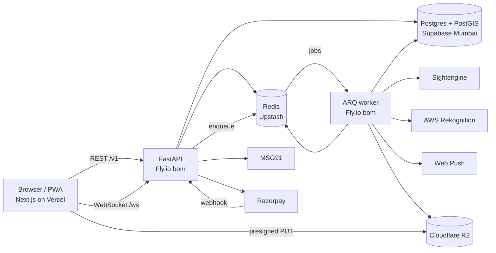
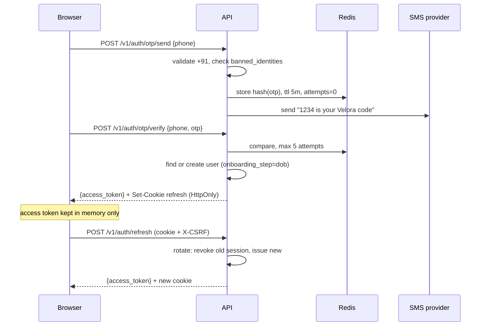

# 02 · Architecture

## 1. System map



## 2. Backend layout and layers

```
api/app/
  main.py                 app factory, middleware, router mounting
  core/
    config.py             pydantic-settings; every env var declared here
    db.py                 async engine, session dependency, transaction helper
    redis.py              client, pub/sub helpers
    security.py           JWT, argon2, OTP generation, CSRF
    errors.py             AppError + handlers → error envelope
    enums.py              the 20 Postgres enum types as Python enums (shared across modules)
    deps.py               current_user, require_role, rate_limit
    pagination.py         cursor encode/decode
    providers/            sms.py payments.py moderation.py facematch.py push.py storage.py
                          each: Protocol + RealImpl + FakeImpl
  modules/
    auth users profiles photos verification discovery swipes matches
    threads messages album kudos gifts safety wallet payments referrals
    notifications admin waitlist realtime
  workers/
    main.py               ARQ WorkerSettings, cron schedule
    tasks/                moderate_photo, verify_selfie, expire_threads, warn_expiring,
                          send_push, recompute_fraud, watermark_album
```

**Each module:** `router.py` (FastAPI routes) · `schemas.py` (Pydantic in/out) · `service.py`
(rules) · `repository.py` (SQL) · `models.py` (SQLAlchemy tables).

**Dependency direction:** router → service → repository → models. A service may call another
module's **service**, never its repository. Nothing imports from `router.py`.

**Transactions** are opened in the service layer with `async with db.begin():`. Repositories take a
session and never commit.

## 3. API conventions

- Base path `/v1`. JSON only. `snake_case` fields.
- **Except the probes:** `/healthz` and `/readyz` are mounted at the root, unversioned. They
  are read by Fly and uptime checks, not clients, so they are not part of the versioned API.
- Auth: `Authorization: Bearer <access_jwt>` on every route except those marked public.
- **Pagination:** cursor-based. Request `?cursor=<opaque>&limit=20` (max 50).
  Response `{ "items": [...], "next_cursor": "..." | null }`.
- **Idempotency:** mutating money routes accept `Idempotency-Key` header; stored for 24h in Redis.
- **Time:** ISO-8601 UTC strings.
- **Error envelope** (every non-2xx):

```json
{ "error": { "code": "INSUFFICIENT_CREDITS", "message": "You need 5 credits.", "details": { "required": 5, "balance": 2 } } }
```

HTTP status mapping: 400 validation · 401 `AUTH_REQUIRED`/`TOKEN_EXPIRED` · 402 `INSUFFICIENT_CREDITS`
· 403 `FORBIDDEN`/`BLOCKED`/`ACCOUNT_FROZEN` · 404 `NOT_FOUND` · 409 conflict codes · 410 `THREAD_EXPIRED`
· 422 business-rule codes · 429 `RATE_LIMITED`. Full code list in `04-API.md`.

## 4. Auth flow

Two providers, one session model. `AUTH_PHONE_PROVIDER` selects which path is live (D-035).

**Path A — Firebase (launch default)**

```mermaid
sequenceDiagram
  participant B as Browser
  participant F as Firebase
  participant A as API
  B->>F: signInWithPhoneNumber(+91…) with App Check + reCAPTCHA
  F-->>B: SMS, then confirm(code) → Firebase ID token
  B->>A: POST /v1/auth/firebase {id_token}
  A->>A: verify signature + aud/iss/exp against Google keys, phone_number present, +91 only
  A->>A: throttle per IP and per phone; check banned_identities
  A->>A: find or create user (same as Path B)
  A-->>B: {access_token} + refresh cookie
```

The Firebase ID token is used once, never stored, and never accepted twice (jti cached in Redis
until expiry).

**Path B — own OTP over MSG91 (after DLT approval)**



- OTP: 4 digits, 5-minute TTL, 5 verify attempts, resend after 45 s, max 5 sends per phone per hour
  and 20 per IP per hour.
- **Refresh reuse detection:** presenting a revoked refresh token revokes the whole session family.
- Phone numbers are stored encrypted (pgcrypto, key from env) plus a peppered SHA-256 hash for lookup.

## 5. Onboarding state machine

`users.onboarding_step`: `dob → gender → seeking → profile → username → about → photos → interests
→ pin → selfie → done`. The API rejects discovery/threads calls with `ONBOARDING_INCOMPLETE` until
`done`. Women cannot reach `done` without an approved selfie verification. `gender` and `dob`
become immutable once `onboarding_step` passes `gender`.

## 6. Real-time protocol

Connect: `POST /v1/ws/ticket` → `{ticket}` (single use, 30 s) → `wss://api.velora.app/ws?ticket=…`.

Envelope, both directions: `{ "type": "…", "id": "<uuid>", "data": { … } }`

| Server → client | When |
|---|---|
| `message.new` | new message in a thread you're in |
| `message.read` | the other person read up to a message |
| `typing` | other person typing (throttled 1/3 s) |
| `thread.opened` | someone opened a thread with you |
| `thread.expiring` | 2 h left |
| `thread.expired` | expired |
| `knot.requested` / `knot.accepted` / `knot.untied` | knot state changes |
| `wallet.updated` | balance changed |
| `album.decided` | album request granted / declined |

| Client → server | Effect |
|---|---|
| `typing` | relayed to the other participant |
| `ping` | server replies `pong`; client reconnects if no pong in 10 s |

Sending messages is **REST** (`POST /v1/threads/{id}/messages`) so it goes through validation,
masking and persistence; the socket only pushes. Client dedupes by `client_msg_id`.
Fan-out: API publishes to Redis channel `user:{id}`; every API instance subscribes for its
connected users.

## 7. Background jobs (ARQ)

| Job | Trigger | Does |
|---|---|---|
| `moderate_photo` | photo upload completed | re-encode, strip EXIF, NSFW/minor check, approve → copy to public bucket |
| `verify_selfie` | selfie submitted | liveness pose check + face match vs approved photos |
| `watermark_album` | album access granted | render per-viewer watermarked copies |
| `send_push` | any notification | Web Push, drop dead subscriptions on 404/410 |
| `expire_threads` | cron, every minute | active threads past `expires_at` → `expired`, emit event |
| `warn_expiring` | cron, every 5 min | threads with <2 h left, warned once |
| `recompute_fraud` | cron every 10 min + on report | recompute score, apply band actions |
| `cleanup` | cron, daily 03:30 IST | purge expired OTP keys, old WS tickets, stale push subs |

Every job is idempotent and safe to retry (max 3, exponential backoff).

## 8. Discovery query (sketch)

```sql
SELECT p.user_id, ST_Distance(p.location, :me) AS dist_m
FROM profiles p
JOIN users u ON u.id = p.user_id
WHERE ST_DWithin(p.location, :me, :radius_m)
  AND u.status = 'active' AND u.onboarding_step = 'done'
  AND p.is_hidden = false
  AND u.gender = ANY(:wanted_genders)
  AND :my_gender = ANY(p.seeking_genders)
  AND NOT EXISTS (SELECT 1 FROM swipes s WHERE s.swiper_id = :me_id AND s.target_id = p.user_id)
  AND NOT EXISTS (SELECT 1 FROM blocks b WHERE (b.blocker_id = :me_id AND b.blocked_id = p.user_id)
                                              OR (b.blocker_id = p.user_id AND b.blocked_id = :me_id))
  -- optional: intents (any overlap: EXISTS on profile_intents, D-041), verified, online filters
ORDER BY rank_score(dist_m, u.last_active_at, u.is_verified, p.completeness) DESC, p.user_id
LIMIT :limit;
```

Indexes that make this fast are listed in `03-SCHEMA.md`. Target: p95 < 80 ms at 50k users.

## 9. Money flows

**Spend (e.g. open a thread):**
1. Service reads price from `action_prices` (cached 60 s).
2. `async with db.begin():` → `wallet.debit(user, amount, reason, ref, idempotency_key)`
   locks the wallet row, checks balance, updates balance, inserts ledger entry.
3. The thing being bought (thread row) is created **in the same transaction**. Either both happen
   or neither does.

**Purchase:**
1. `POST /v1/payments/orders {pack_id}` → server creates Razorpay order, stores `payments` row
   (`created`), returns `order_id` + public key.
2. Browser opens Razorpay Checkout.
3. Razorpay → `POST /v1/payments/webhook` (`payment.captured`). Verify signature. Look up by
   `razorpay_order_id`. If `razorpay_payment_id` already recorded → return 200, do nothing.
   Else in one transaction: mark `paid`, credit pack + bonus via `wallet.credit()`.
4. Browser polls `GET /v1/payments/{id}` until `paid`, then refreshes wallet.

**Refund when a partner is banned:** admin ban → service finds credits the reporter/others spent on
that person in the last 7 days → `wallet.credit(reason=refund_banned_partner)`.

## 10. Uploads and moderation

1. `POST /v1/photos/upload-url {kind}` → `{photo_id, put_url, headers}` (5 min, max 8 MB, image/*).
2. Browser PUTs directly to `velora-private/raw/{user_id}/{photo_id}`.
3. `POST /v1/photos/{id}/complete` → status `pending`, enqueue `moderate_photo`.
4. Worker: download, verify it's really an image, re-encode to JPEG (max 1600 px, strips EXIF/GPS),
   run moderation. Approved → write to `velora-public/p/{photo_id}.jpg`, status `approved`.
   Rejected → status `rejected` with reason code, notify user.
5. Only `approved` photos are ever returned to other users.

## 11. Configuration (every env var)

| Var | Used by | Notes |
|---|---|---|
| `ENV` | api, worker | `local` / `staging` / `production` — required, no default: a deploy that forgets it refuses to start rather than becoming `local` |
| `DATABASE_URL` | api, worker | `postgresql+asyncpg://…` |
| `REDIS_URL` | api, worker | |
| `DB_POOL_SIZE`, `DB_MAX_OVERFLOW` | api, worker | per process (default 5 and 5); budget = processes × (both), recorded in `infra/STAGING.md` |
| `JWT_SECRET` | api | 64+ random bytes |
| `PHONE_PEPPER`, `PHONE_ENC_KEY` | api | never rotate without a migration plan |
| `CORS_ORIGINS` | api | comma list, exact origins |
| `COOKIE_DOMAIN` | api | `.velora.app` |
| `AUTH_PHONE_PROVIDER` | api, web | `firebase` \| `msg91` \| `fake` |
| `FIREBASE_PROJECT_ID`, `FIREBASE_SERVICE_ACCOUNT_JSON` | api | token verification |
| `NEXT_PUBLIC_FIREBASE_*` | web | apiKey, authDomain, projectId, appId, App Check site key — public by design |
| `SMS_PROVIDER` | api | `msg91` \| `fake` (`fake` locally) |
| `MSG91_AUTH_KEY`, `MSG91_TEMPLATE_ID`, `MSG91_SENDER_ID` | api | Path B only |
| `PAYMENTS_PROVIDER` | api | `razorpay` \| `fake` (`fake` locally) |
| `RAZORPAY_KEY_ID`, `RAZORPAY_KEY_SECRET`, `RAZORPAY_WEBHOOK_SECRET` | api | |
| `MODERATION_PROVIDER` | worker | `sightengine` \| `fake` |
| `SIGHTENGINE_API_USER`, `SIGHTENGINE_API_SECRET` | worker | |
| `FACEMATCH_PROVIDER` | worker | `rekognition` \| `fake` |
| `AWS_ACCESS_KEY_ID`, `AWS_SECRET_ACCESS_KEY`, `AWS_REGION` | worker | `AWS_REGION` defaults to `ap-south-1` |
| `R2_ACCOUNT_ID`, `R2_ACCESS_KEY_ID`, `R2_SECRET_ACCESS_KEY`, `R2_BUCKET_PUBLIC`, `R2_BUCKET_PRIVATE`, `PUBLIC_CDN_URL` | api, worker | |
| `STORAGE_PROVIDER` | api, worker | `s3` \| `fake` (`s3` covers R2 and local MinIO, T-4.1) |
| `R2_ENDPOINT_URL` | api, worker | S3 endpoint override; points at local MinIO, empty for real R2 |
| `PUSH_PROVIDER` | api, worker | `webpush` \| `fake` |
| `VAPID_PUBLIC_KEY`, `VAPID_PRIVATE_KEY`, `VAPID_SUBJECT` | api, worker | public key also in web |
| `SENTRY_DSN` | all | |
| `NEXT_PUBLIC_API_URL`, `NEXT_PUBLIC_WS_URL`, `NEXT_PUBLIC_VAPID_PUBLIC_KEY`, `NEXT_PUBLIC_RAZORPAY_KEY_ID`, `NEXT_PUBLIC_SENTRY_DSN` | web | public by definition |

Every `*_PROVIDER` may be `fake` only while `ENV` is `local`. Anywhere else the API refuses to
start, naming each fake, until a real provider is set (D-045) — a fake gateway grants free
credits and a fake sign-in lets anyone in as anyone.

`.env.example` in each app lists every var. Values that point at local infrastructure from
`infra/docker-compose.yml` are filled in so a fresh clone runs with no setup; every genuine
secret is left empty. Real secret values are never committed.

## 12. Security baseline

- CORS: exact origins only, credentials allowed.
- Web headers (Next.js): CSP (self + Razorpay + R2 CDN + API + Firebase Auth and Google reCAPTCHA domains for Path A), HSTS, `X-Frame-Options: DENY`,
  `Referrer-Policy: strict-origin-when-cross-origin`, `Permissions-Policy` allowing camera,
  microphone, geolocation for self only.
- Rate limits (Redis, sliding window):

| Route group | Limit |
|---|---|
| OTP send (Path B) | 5 / phone / hour · 20 / IP / hour |
| `/auth/firebase` (Path A) | 10 / IP / hour · 5 / phone / hour |
| OTP verify | 5 attempts / code |
| Swipes | 120 / min (plus daily cap 50 for men, from `app_config`) |
| Send message | 30 / min / user |
| Reports | 10 / day / user |
| Username check | 30 / min |
| Everything else | 300 / min / user |

- Logs are structured JSON with `request_id`; never log phone, OTP, tokens, message bodies.
- Admin routes require `role in (moderator, admin)`; every admin action writes `audit_log`.

## 13. Environments

| | local | staging | production |
|---|---|---|---|
| Web | `pnpm dev` :3000 | Vercel project `velora-staging` (its own; stable URL) | Vercel prod `velora.app` |
| API | uvicorn :8000 | Fly `velora-api-staging` | Fly `velora-api` |
| DB | docker postgis | Supabase project `velora-staging` | Supabase `velora-prod` |
| Providers | fake | real (test keys) | real (live keys) |

Deploy: merge to `main` → CI → staging automatically, for that commit only once its CI passed
(`deploy.yml`, D-046; set up by `infra/STAGING.md`). Git tag `v*` → production.
