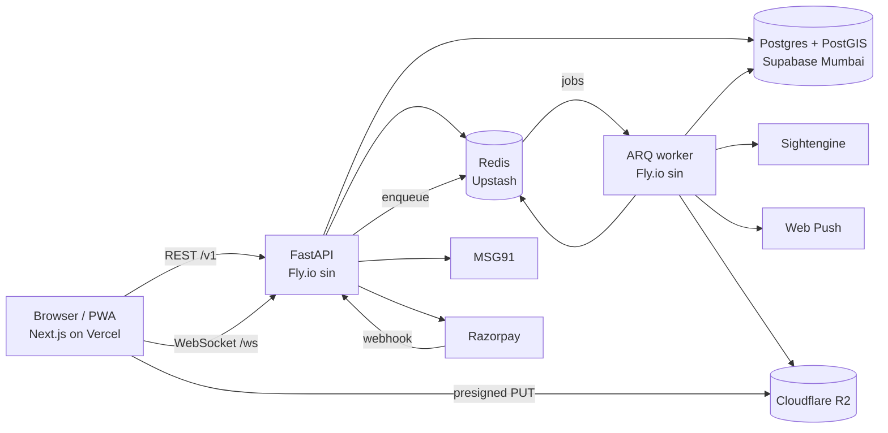
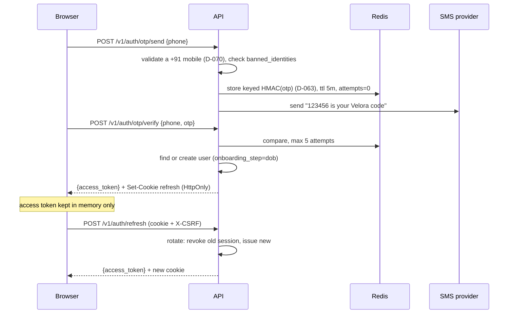

# 02 · Architecture

## 1. System map



## 2. Backend layout and layers

```
api/app/
  main.py                 app factory, middleware, router mounting
  core/
    config.py             pydantic-settings; every env var declared here
    db.py                 async engine, session dependency, transaction helper
    redis.py              client, pub/sub helpers
    events.py             socket events: queued on the session, published after commit (T-5.1)
    security.py           phone numbers, access and refresh tokens, PINs, CSRF (D-060)
    errors.py             AppError + handlers → error envelope
    enums.py              the 20 Postgres enum types as Python enums (shared across modules)
    deps.py               current_user, require_role, rate_limit
    pagination.py         cursor encode/decode
    providers/            sms.py payments.py moderation.py facematch.py push.py storage.py
                          each: Protocol + RealImpl + FakeImpl
  modules/
    auth users profiles photos verification discovery swipes matches
    threads messages album kudos gifts safety wallet payments referrals
    notifications admin waitlist realtime
  workers/
    main.py               ARQ WorkerSettings, cron schedule
    tasks/                moderate_photo, verify_selfie, expire_threads, warn_expiring,
                          send_push, recompute_fraud, watermark_album
```

**Each module:** `router.py` (FastAPI routes) · `schemas.py` (Pydantic in/out) · `service.py`
(rules) · `repository.py` (SQL) · `models.py` (SQLAlchemy tables).

**Dependency direction:** router → service → repository → models. A service may call another
module's **service**, never its repository. Nothing imports from `router.py`.

**Transactions** are opened in the service layer with `async with db.begin():`. Repositories take a
session and never commit.

## 3. API conventions

- Base path `/v1`. JSON only. `snake_case` fields.
- **Except the probes:** `/healthz` and `/readyz` are mounted at the root, unversioned. They
  are read by Fly and uptime checks, not clients, so they are not part of the versioned API.
- Auth: `Authorization: Bearer <access_jwt>` on every route except those marked public.
- **Pagination:** cursor-based. Request `?cursor=<opaque>&limit=20` (max 50).
  Response `{ "items": [...], "next_cursor": "..." | null }`.
- **Idempotency:** mutating money routes accept an `Idempotency-Key` header. The guarantee is the
  ledger's own key in Postgres, permanent and namespaced by the wallet module (D-077); a client's
  key only ever fills its event part. A Redis store, if a route builds one (T-8.1 or T-8.9), only
  replays the earlier response. It is never what stops a double charge.
- **Time:** ISO-8601 UTC strings.
- **Error envelope** (every non-2xx):

```json
{ "error": { "code": "INSUFFICIENT_CREDITS", "message": "You need 5 credits.", "details": { "required": 5, "balance": 2 } } }
```

HTTP status mapping: 400 validation · 401 `AUTH_REQUIRED`/`TOKEN_EXPIRED` · 402 `INSUFFICIENT_CREDITS`
· 403 `FORBIDDEN`/`BLOCKED`/`ACCOUNT_FROZEN` · 404 `NOT_FOUND` · 409 conflict codes · 410 `THREAD_EXPIRED`
· 422 business-rule codes · 429 `RATE_LIMITED`. Full code list in `04-API.md`.

## 4. Auth flow

Two providers, one session model. `AUTH_PHONE_PROVIDER` selects which path is live (D-035).

**Path A — Firebase (launch default)**

```mermaid
sequenceDiagram
  participant B as Browser
  participant F as Firebase
  participant A as API
  B->>F: signInWithPhoneNumber(+91…) with invisible reCAPTCHA (App Check from P-68)
  F-->>B: SMS, then confirm(code) → Firebase ID token
  B->>A: POST /v1/auth/firebase {id_token}
  A->>A: verify signature + aud/iss/exp/iat/auth_time against Google keys, a phone sign-in, +91 only
  A->>A: used once; throttle per IP and per phone; check banned_identities
  A->>A: find or create user (same as Path B)
  A-->>B: {access_token, user} + refresh and CSRF cookies
  B->>F: signOut: we keep our own session
```

The Firebase ID token is used once, never stored, and never accepted twice. It carries no `jti`,
so its SHA-256 is held in Redis until it would expire (D-085). Its sign-in must be under 5 minutes
old. Served only where `AUTH_PHONE_PROVIDER` is `firebase`; 404 elsewhere (D-085). The browser asks
Google for the SMS, so none of our server's limits stands in front of a send (D-035, P-0.18).

**Path B — own OTP over MSG91 (after DLT approval)**



- OTP (Path B, served only where `AUTH_PHONE_PROVIDER` is `msg91` or `fake`): 6 digits, 5-minute
  TTL, 5 verify attempts per code and 10 wrong codes per phone per 24 hours, resend after 45 s;
  send limits and the global daily cap are in §12 (D-066). Only Indian mobile numbers sign in
  (D-070).
- **Refresh reuse detection:** presenting a revoked refresh token revokes the whole session family,
  unless it was rotated less than 10 seconds ago, which two tabs refreshing at once cause: that
  is refused without revoking (D-067). Logout authenticates like refresh, by cookie and `X-CSRF`.
- Phone numbers are stored encrypted in the API (Fernet, `PHONE_ENC_KEY`), never by the database,
  plus an HMAC-SHA256 keyed by `PHONE_PEPPER` for lookup (D-061). PINs are argon2id over a
  pepper kept off the database (D-062).

## 5. Onboarding state machine

`users.onboarding_step`: `dob → gender → seeking → profile → username → about → photos → interests
→ pin → selfie → done`. The API rejects discovery/threads calls with `ONBOARDING_INCOMPLETE` until
`done`. Women cannot reach `done` without an approved selfie verification. Each step's endpoint
works at its step (advancing it) and after it (an edit that doesn't advance), and refuses before
it with `ONBOARDING_INCOMPLETE` and the current step (D-068). `gender` and `dob` are immutable
once set (T-1.9's trigger), and a date of birth under 18 deletes the account, keeping only the
number's hash (D-072).

## 6. Real-time protocol

Connect: `POST /v1/ws/ticket` → `{ticket}` (single use, 30 s) → `wss://api.veloraapp.co.in/ws?ticket=…`.

Envelope, both directions: `{ "type": "…", "id": "<uuid>", "data": { … } }`

| Server → client | When |
|---|---|
| `message.new` | new message in a thread you're in |
| `message.read` | the other person read up to a message |
| `typing` | other person typing (throttled 1/3 s) |
| `thread.opened` | someone opened a thread with you |
| `thread.expiring` | 2 h left |
| `thread.expired` | expired |
| `knot.requested` / `knot.accepted` / `knot.untied` | knot state changes |
| `wallet.updated` | balance changed |
| `album.decided` | album request granted / declined |

| Client → server | Effect |
|---|---|
| `typing` | relayed to the other participant |
| `ping` | server replies `pong`; client reconnects if no pong in 10 s |

Sending messages is **REST** (`POST /v1/threads/{id}/messages`) so it goes through validation,
masking and persistence; the socket only pushes. Client dedupes by `client_msg_id`.
Fan-out: API publishes to Redis channel `user:{id}`; every API instance subscribes for its
connected users. A service queues an event in the transaction that makes it true; `get_session`
publishes the request's committed events when the request ends, after its session has closed, and
a failed or hung publish (1 s) is logged without failing the request (`core/events.py`, T-5.1).

## 7. Background jobs (ARQ)

| Job | Trigger | Does |
|---|---|---|
| `moderate_photo` | photo upload completed | re-encode (D-092: decoded and encoded afresh, so no EXIF survives), score with Sightengine (D-094), decide: approve → the scored bytes to the public bucket; a possible minor → rejected, a `fraud_events` score, every copy deleted (D-093) |
| `delete_files` | under-18 refusal, before its commit | delete the refused user's files once they're gone, each read back (D-090) |
| `verify_selfie` | selfie submitted | face match vs approved photos, on the worker itself: YuNet and SFace (D-088), no third party (D-087); liveness is T-4.11's, and nothing claims it until then |
| `watermark_album` | album access granted | render per-viewer watermarked copies |
| `send_push` | any notification | Web Push, drop dead subscriptions on 404/410 |
| `expire_threads` | cron, every minute | active threads past `expires_at` → `expired`, emit event |
| `warn_expiring` | cron, every 5 min | threads with <2 h left, warned once |
| `recompute_fraud` | cron every 10 min + on report | recompute score, apply band actions |
| `cleanup` | cron, daily 03:30 IST | purge expired OTP keys, old WS tickets, stale push subs |

Every job is idempotent and safe to retry (max 3, exponential backoff).

The worker (T-4.4) is `python -m app.workers` (`make worker`): the API's image and `Settings`, the
same database role, its own Fly app (`infra/fly.worker.toml`, D-095). It polls every
`WORKER_POLL_DELAY_S`, 10 seconds (D-091), and refuses to start without what its jobs need.
ARQ logs each job's arguments as it starts it; the worker writes the job's name instead, since
`delete_files`' arguments are storage keys (rule 15).

## 8. Discovery query (sketch)

```sql
SELECT p.user_id, ST_Distance(p.location, :me) AS dist_m
FROM profiles p
JOIN users u ON u.id = p.user_id
WHERE ST_DWithin(p.location, :me, :radius_m)
  AND u.status = 'active' AND u.onboarding_step = 'done'
  AND p.is_hidden = false
  AND u.gender = ANY(:wanted_genders)
  AND :my_gender = ANY(p.seeking_genders)
  AND NOT EXISTS (SELECT 1 FROM swipes s WHERE s.swiper_id = :me_id AND s.target_id = p.user_id)
  AND NOT EXISTS (SELECT 1 FROM blocks b WHERE (b.blocker_id = :me_id AND b.blocked_id = p.user_id)
                                              OR (b.blocker_id = p.user_id AND b.blocked_id = :me_id))
  -- optional: intents (any overlap: EXISTS on profile_intents, D-041), verified, online filters
ORDER BY rank_score(dist_m, u.last_active_at, u.is_verified, p.completeness) DESC, p.user_id
LIMIT :limit;
```

Indexes that make this fast are listed in `03-SCHEMA.md`. Target: p95 < 80 ms at 50k users.

## 9. Money flows

**Spend (e.g. open a thread):**
1. `async with db.begin():` → `pricing.service.charge(session, user, action, ref=Ref(...))` reads
   the price from `action_prices` inside that transaction, with no cache, so it charges the price
   as it is now: 0 for a woman, the row's value for a man (T-5.2). Only above 0 does it call
   `wallet.debit()`, and nothing else may, but gift sending (T-8.9, priced from `gifts`); a test
   holds that as an allowlist.
2. `wallet.debit(session, user_id, amount, reason, ref=Ref(...))` locks the wallet row, checks
   balance, updates balance, inserts ledger entry. The caller never builds the key: the wallet
   does, from the reason and the ref, or from an event the caller names for the reasons that
   repeat (`thread_reopen`, `thread_extend`, `admin_grant`). A retry returns the first entry with
   `applied=False` (D-077, T-5.1).
3. The thing being bought (thread row) is created **in the same transaction**. Either both happen
   or neither does.

**Purchase:**
1. `POST /v1/payments/orders {pack_id}` → server creates Razorpay order, stores `payments` row
   (`created`), returns `order_id` + public key.
2. Browser opens Razorpay Checkout.
3. Razorpay → `POST /v1/payments/webhook` (`payment.captured`). Verify signature. Look up by
   `razorpay_order_id`. If `razorpay_payment_id` already recorded → return 200, do nothing.
   Else in one transaction: mark `paid`, credit pack + bonus via `wallet.credit()`.
4. Browser polls `GET /v1/payments/{id}` until `paid`, then refreshes wallet.

**Nothing is returned on a ban** (D-230, 4 October 2026): there is no product refund, so T-9.3 is
dropped and `refund_banned_partner` stays unused. Money goes back only for a chargeback (D-076
rule 3, T-8.2) or a duplicate charge (T-8.3).

## 10. Uploads and moderation

1. `POST /v1/photos/upload-url {kind, position?, content_type}` → `{photo_id, put_url, headers}` (5 min; JPEG, PNG or WebP; the declared type is signed in, a hint only, D-089).
2. Browser PUTs directly to `velora-private/raw/{user_id}/{photo_id}`.
3. `POST /v1/photos/{id}/complete` → the object's size (at most 8 MB) and its first bytes decide; status `pending`, enqueue `moderate_photo` (a selfie waits for T-4.5).
4. Worker (T-4.4): read at most 8 MB and judge the bytes again (the PUT URL outlives `complete`);
   decode with Pillow, only as that format, refusing more than 40 megapixels before decoding
   (D-092); turn it upright, longest side 1600, a new JPEG at quality 85 from the pixels alone
   (no EXIF, XMP, ICC or anything appended survives); **write it over the upload**, so no
   original with its location is kept; score it with Sightengine (`nudity-2.1`, `face-age`,
   `text`, the plain image API only, D-094). Approved → the bytes scored written to
   `velora-public/p/{photo_id}.jpg`, status `approved`. Rejected → status `rejected` with a
   reason (`nudity`, `no_face` for public photos, `text_overlay`; `other` or `too_large` if it
   can't be read, its file deleted), the re-encoded copy kept privately for review. A possible
   minor (`minor_suspected`, D-093) → rejected, a `fraud_events` score kept, every copy deleted
   and read back as gone; what its owner reads names no minor (D-093, T-4.6). Sightengine or storage failing three
   times leaves it `pending`, logged at error level. Notifying the user is T-9.4's.
5. Only `approved` photos are ever returned to other users.

## 11. Configuration (every env var)

| Var | Used by | Notes |
|---|---|---|
| `ENV` | api, worker | `local` / `staging` / `production` — required, no default: a deploy that forgets it refuses to start rather than becoming `local` |
| `APP_ENV` | web (build) | `local` / `ci` / `staging` / `production`. Read while the legal pages build: a missing legal fact is allowed only where it's `local`, `ci` or `staging` (or under `next dev`); unset or anything else fails the build (D-053) |
| `DATABASE_URL` | api, worker | `postgresql+asyncpg://…` |
| `REDIS_URL` | api, worker | |
| `DB_POOL_SIZE`, `DB_MAX_OVERFLOW` | api, worker | per process (default 5 and 5); budget = processes × (both), recorded in `infra/STAGING.md` |
| `JWT_SECRET` | api, worker | `openssl rand -hex 64`: at least 128 hex characters, checked at startup (D-060) |
| `PHONE_PEPPER` | api, worker | `openssl rand -hex 32`. Never changes once a number is banned: a ban keeps only the hash (D-061) |
| `PHONE_ENC_KEY` | api, worker | `openssl rand -hex 32`. One key, or several separated by commas, newest first: the first encrypts, every one decrypts, so adding a key is a config change (D-061) |
| `CODE_PEPPER` | api, worker | `openssl rand -hex 32`. The key behind PIN hashes, and OTP codes from T-3.2, kept off the database (D-062, D-063). Never `PHONE_PEPPER`'s value |
| `CORS_ORIGINS` | api | comma list, exact origins |
| `COOKIE_DOMAIN` | api | the readable CSRF cookie's domain (D-055): `veloraapp.co.in` in production, `staging.veloraapp.co.in` on staging. The refresh cookie has none: host-only on the API (D-054) |
| `CLIENT_IP_HEADER` | api | the header the platform's proxy puts the client's IP in, for per-IP rate limits: `Fly-Client-IP` on Fly. Empty only where `ENV` is `local`, which reads the socket (D-056) |
| `AUTH_PHONE_PROVIDER` | api | `firebase` \| `msg91` \| `fake`. The web never reads it: a build signs in by the path its `APP_ENV` names, Path B where it's `local` or `ci`, Firebase on `staging` and `production` (D-081) |
| `FIREBASE_PROJECT_ID` | api | token verification: the project whose ID tokens sign in. A token's audience must be it and its issuer `https://securetoken.google.com/` followed by it; with Google's public keys, that is all verifying takes. Required where `AUTH_PHONE_PROVIDER` is `firebase`, checked at startup; `velora-ic` on staging and production, in each Fly config's `[env]`, until P-66 (D-065, D-085). No service account: none is needed to verify, and an unneeded one is a key guarded for nothing (P-39's deletes would need one, and would add it then, with the reason) |
| Firebase web config | web (build) | not a variable: apiKey, authDomain, projectId and appId are committed in `web/src/lib/firebase-config.ts`, by `APP_ENV`, staging and production only, public by design (D-085). `next.config` builds this `APP_ENV`'s into the bundle; local and ci get none. App Check's site key joins it with P-68 |
| `SMS_PROVIDER` | api | `msg91` \| `fake` (`fake` locally) |
| `SMS_LOCAL_ALLOWED_TO` | api | locally, the only numbers a real SMS provider is called for: comma-separated, each passing `normalize_phone` at startup, empty by default. Any other number gets `503 PROVIDER_UNAVAILABLE` and its code is discarded, because the seed's numbers may be real people's (D-064). Refused outside local, where it would look like protection it isn't (D-066) |
| `MSG91_AUTH_KEY`, `MSG91_TEMPLATE_ID`, `MSG91_SENDER_ID` | api | Path B only |
| `PAYMENTS_PROVIDER` | api | `razorpay` \| `fake` (`fake` locally) |
| `RAZORPAY_KEY_ID`, `RAZORPAY_KEY_SECRET`, `RAZORPAY_WEBHOOK_SECRET` | api | |
| `WORKER_POLL_DELAY_S` | worker | seconds between the worker's looks at the queue, default 10 (D-091): 260,640 Redis commands a month idle on Upstash Free, 52% of its 500K. Redo that sum before changing it |
| `MODERATION_PROVIDER` | worker | `sightengine` \| `fake` |
| `SIGHTENGINE_API_USER`, `SIGHTENGINE_API_SECRET` | worker | with `sightengine`, the worker refuses to start without both, naming them (`python -m app.workers --check`, Fly's release command). The API never moderates, so it needs neither |
| `FACEMATCH_PROVIDER` | worker | `sface` \| `fake`: on the worker, no keys and no third party (D-087, D-088) |
| `R2_ACCOUNT_ID`, `R2_ACCESS_KEY_ID`, `R2_SECRET_ACCESS_KEY`, `R2_BUCKET_PUBLIC`, `R2_BUCKET_PRIVATE`, `PUBLIC_CDN_URL` | api, worker | all required with `s3`, named at startup (T-4.1). The account ID and the CDN aren't secrets (each Fly config's `[env]`); the token is, scoped to its environment's two buckets. `PUBLIC_CDN_URL` is `https://` with no trailing slash outside local |
| `STORAGE_PROVIDER` | api, worker | `s3` \| `fake` (`s3` covers R2 and the local S3, SeaweedFS, T-4.1, D-086; `api/.env.example` uses the local one) |
| `R2_ENDPOINT_URL` | api, worker | the local S3 (D-086), and only where `ENV` is local: refused anywhere else, an allowlist (rule 16), so storage goes to R2's own endpoint for `R2_ACCOUNT_ID` (T-4.1) |
| `PUSH_PROVIDER` | api, worker | `webpush` \| `fake` |
| `VAPID_PUBLIC_KEY`, `VAPID_PRIVATE_KEY`, `VAPID_SUBJECT` | api, worker | public key also in web |
| `SENTRY_DSN` | all | |
| `NEXT_PUBLIC_API_URL`, `NEXT_PUBLIC_WS_URL`, `NEXT_PUBLIC_VAPID_PUBLIC_KEY`, `NEXT_PUBLIC_RAZORPAY_KEY_ID`, `NEXT_PUBLIC_SENTRY_DSN` | web | public by definition |

The four keys above are checked for shape at startup, everywhere, and the repo's public test keys
(`PUBLIC_TEST_KEYS` in `core/config.py`) are refused unless `ENV` is `local` (D-060).

Every `*_PROVIDER` may be `fake` only while `ENV` is `local`. Anywhere else the API refuses to
start, naming each fake, until a real provider is set (D-045) — a fake gateway grants free
Velas and a fake sign-in lets anyone in as anyone.

`.env.example` in each app lists every var. Values that point at local infrastructure from
`infra/docker-compose.yml` are filled in so a fresh clone runs with no setup; every genuine
secret is left empty. Real secret values are never committed.

## 12. Security baseline

- CORS: exact origins only, credentials allowed.
- Web headers (Next.js, from `web/src/lib/security-headers.ts`, D-059), on every response: an
  enforced CSP, `default-src 'self'; script-src 'self' 'unsafe-inline'; connect-src 'self' <the
  API>; object-src 'none'; base-uri 'none'; form-action 'self'; frame-ancestors 'none'`;
  `X-Frame-Options: DENY`; `X-Content-Type-Options: nosniff`; `Referrer-Policy:
  strict-origin-when-cross-origin`; and `Permissions-Policy: camera=(), microphone=(),
  geolocation=(), browsing-topics=()`; and `Strict-Transport-Security: max-age=63072000;
  includeSubDomains`, never preloaded before launch (D-074). **This is what is served, not a
  target.** On builds that sign in by Firebase (staging and production, D-081), T-3.14 adds
  reCAPTCHA's hosts to `script-src` (`https://www.google.com/recaptcha/`,
  `https://www.gstatic.com/recaptcha/`), a `frame-src 'self' https://www.google.com/recaptcha/
  https://recaptcha.google.com/recaptcha/`, and to `connect-src` reCAPTCHA's and Firebase Auth's
  (`https://www.google.com/recaptcha/`, `https://identitytoolkit.googleapis.com`,
  `https://securetoken.googleapis.com`); Path B builds have none of them (D-085). T-4.6 adds
  photos, on builds with photo storage by `APP_ENV` (`web/src/lib/storage-origins.ts`): to
  `connect-src` the private bucket, by its path on the storage endpoint, for the presigned PUT
  (staging's `https://<R2_ACCOUNT_ID>.r2.cloudflarestorage.com/velora-staging-private/`); and an
  `img-src 'self' blob: <the private bucket> <the CDN>`, for previews, the signed links pending and
  private photos are shown by, and approved public photos (`https://cdn.staging.veloraapp.co.in`).
  Never the whole endpoint, which staging and production share, and never a wildcard. Each task
  that needs more widens it there, deliberately: App Check (P-68), the camera
  (T-4.7), location (T-4.10), the microphone
  (T-7.11), WebSockets (T-7.12), Razorpay (T-8.7), Sentry (T-9.12) and analytics (T-10.2). This
  line changes with each.
- API headers (`app/core/headers.py`, P-42): `X-Content-Type-Options: nosniff` on every
  response and `Cache-Control: no-store` on every `/v1` response, 500s and CORS preflights
  included: a sign-in carries an access token, and `/me` on, one person's data.
- Rate limits (Redis, sliding window):

| Route group | Limit |
|---|---|
| OTP send (Path B) | 5 / phone / hour · 20 / IP / hour · 100 / IPv6 /48 / hour · 10 / phone / day · `otp_sms_daily_cap` (500) in all / day (D-066) |
| `/auth/firebase` (Path A) | 10 / IP / hour · 5 / phone / hour |
| OTP verify | 5 attempts / code · 10 wrong / phone / 24 h (D-066) |
| PIN set and verify | 10 / min / user (D-069) |
| Swipes | 120 / min (plus daily cap 50 for men, from `app_config`) |
| Send message | 30 / min / user |
| Reports | 10 / day / user |
| Username check | 30 / min / user |
| Waitlist | 5 / min / IP, invalid tries included (D-056) |
| `GET /prices` | None (T-5.2): public and read-only, one read of a table of about ten rows, as `/readyz` with none; a per-IP limit would mostly catch men behind one carrier's shared address. Flooding is the edge's to stop |
| Everything else | 300 / min / user, in `current_user`, so every authenticated route has it (T-3.5) |

- Logs are structured JSON with `request_id`; never log phone, OTP, tokens, message bodies.
- Admin routes require `role in (moderator, admin)`; every admin action writes `audit_log`.

## 13. Environments

| | local | staging | production |
|---|---|---|---|
| Web | `pnpm dev` :3000 | Vercel project `velora-staging` at `staging.veloraapp.co.in` | Vercel project `velora-production` at `veloraapp.co.in` |
| API | uvicorn :8000 | Fly `velora-api-staging` at `api.staging.veloraapp.co.in` | Fly `velora-api` at `api.veloraapp.co.in`, until P-49 |
| DB | docker postgis | Supabase project `velora-staging` | Supabase project `velora-prod`, in its own organisation |
| Providers | fake | real (test keys) | real (live keys) |

Deploy: merge to `main` → CI → staging automatically, for that commit only once its CI passed
(`deploy.yml`, D-046; set up by `infra/STAGING.md`). A tag `v*` on a commit of `main` → production
(`deploy-production.yml`, D-075; set up by `infra/PRODUCTION.md`), and only once `scripts/release-gate`
finds CI passed for that commit and staging deployed it, with Vercel and velora-prod's Supabase
organisation both on paid plans. The first release is REL-1.
